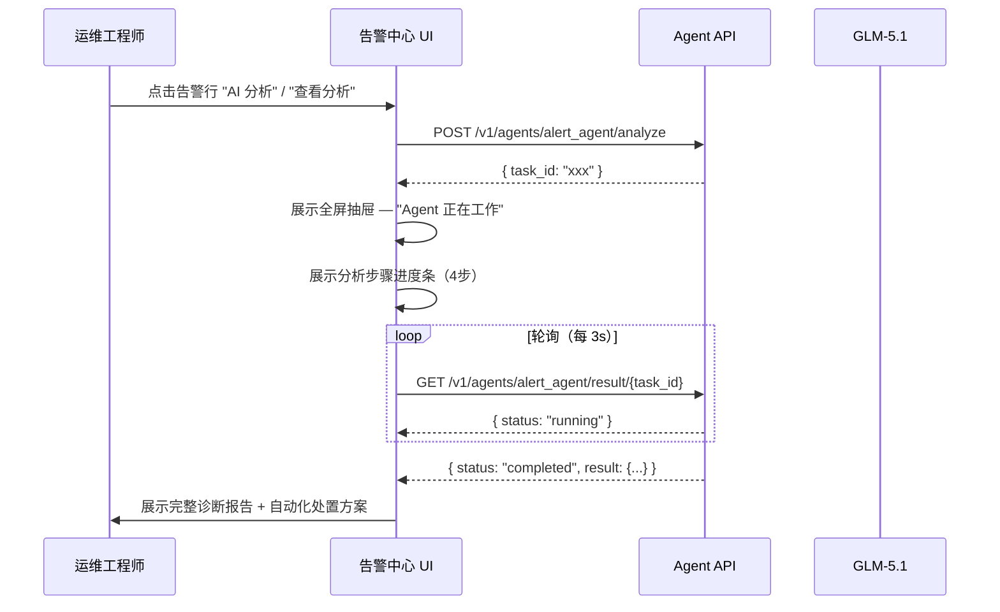

# AI 能力集成 — 功能设计文档

> **Feature**：agent-demo-homepage
> **版本**：v2.0
> **日期**：2026-05-26
> **作者**：PM Team

---

## 1. 功能定位

在 EMS 统一平台入口中嵌入 AI Agent 能力，实现：

| 能力 | 落地页面 | 目标用户 |
|:-----|:---------|:---------|
| 告警 AI 根因分析 | 告警中心（alert-center-v2.html） | ITOM 运维工程师 |
| Agent 生命周期管理 | Agent Hub（ai-management-v2.html） | 平台管理员 |

---

## 2. 告警中心 — AI 根因分析

### 2.1 用户流程



### 2.2 页面结构

| 区域 | 描述 |
|:-----|:-----|
| **统计卡片**（4 卡片） | 活跃告警数(47)、紧急(2)、严重(2)、已恢复(31) |
| **AI Agent 状态面板** | 常驻面板，展示 alert_agent 运行状态、今日分析统计 |
| **筛选栏** | 搜索 + 等级筛选 + 状态筛选 + AI分析状态筛选 + 批量确认/导出 |
| **告警列表** | 数据表格：等级/告警对象/描述/AI分析状态/触发时间/持续时间/状态/操作 |
| **分页** | 共47条，分页展示 |
| **分析抽屉**（85%宽度） | 双栏布局：左侧告警详情+分析结果，右侧自动化处置 |

### 2.3 AI Agent 状态面板

页面中嵌入的粉色边框面板：
- 标题："AI 根因分析 Agent" + 实时脉冲动画点
- 副标题：`alert_agent · GLM-5.1 · 运行中`
- 内容：今日完成次数、平均耗时、分析成功率

### 2.4 告警列表表头

| 列 | 说明 |
|:---|:-----|
| 勾选框 | 批量操作 |
| 等级 | Badge：紧急(红)/严重(橙)/一般(蓝) |
| 告警对象 | 设备名 + IP |
| 告警描述 | 一行文本描述 |
| AI 分析 | Tag：✓ 根因已定位 / ⏳ 分析中 / 待分析 |
| 触发时间 | 时间戳 |
| 持续时间 | 红色高亮超长持续 |
| 状态 | Badge：告警/已恢复 |
| 操作 | "查看分析"/"查看进度"/"AI分析" 链接 |

### 2.5 分析抽屉（核心交互）

抽屉宽度 85%，双栏布局：

**左栏（flex:3）— 告警详情与分析结果：**

1. **告警基本信息** — 设备、状态、时间、持续时间、来源、描述
2. **AI 根因分析**
   - 分析状态标签（完成/进行中 + 耗时）
   - 分析元信息（模板名、模型、数据源）
   - 分析结论（绿色高亮卡片，一段话总结根因）
   - AI 思考过程（可折叠，4步骤）
3. **事件时间线** — 竖线时间轴，按时序展示关联事件
4. **根因排名** — 按置信度降序，含证据说明（如 92% / 5% / 3%）
5. **相似历史案例** — 近1个月、相似度 ≥ 50%、最多3条，含解决方案
6. **评分反馈** — 5星评价

**右栏（flex:2）— 自动化处置：**

1. Tab 切换："AI 推荐" / "运维脚本"
2. 推荐处置方案卡片（匹配度、风险等级 L1/L2/L3）
3. 脚本详情（步骤、成功率、平均耗时）
4. "执行选中方案" 按钮（复用 ITOM 既有自动化执行链路）
5. API 信息展示

**执行规则：**
- 本页“执行选中方案”复用 ITOM 已有执行脚本、执行引擎与风险分级规则，不在 EMS 侧重新建设执行引擎；审批链路与状态口径保持与 ITOM 自动化审批流程一致，直接继承 ITOM 既有审批流程定义。
- L1 低风险：用户点击后直接执行，并在抽屉内回显执行结果。
- L2 中风险：用户点击后进入确认执行流程，确认后执行。
- L3 高风险：用户点击后提交审批流程，审批通过后执行。

**处置区业务规则：**
- 仅当 AI 分析状态为“已完成”且存在至少 1 条推荐处置方案时，右栏展示可执行方案与“执行选中方案”按钮。
- AI 分析处于“待分析 / 分析中 / 分析失败 / 分析超时”时，右栏仅展示说明信息，不提供执行入口。
- 同一时刻仅允许选中 1 条处置方案执行，切换 Tab 或折叠脚本详情不改变当前选中项。
- 若未返回 `recommendations`，右栏展示“暂无匹配处置方案”，并保留脚本详情只读查看。

**执行反馈规则：**
- L1 低风险：点击后按钮进入“执行中”态；执行完成后，在当前抽屉中回显成功/失败结果，并记录最近一次执行时间。
- L2 中风险：点击后先弹出确认框，展示方案名称、风险等级与影响对象；用户确认后进入“执行中”，取消则不改变当前状态。
- L3 高风险：点击后进入“提交审批”流程；提交成功后，方案卡片状态变为“待审批”，主按钮切换为“查看审批状态”。
- 审批通过后，方案自动进入“执行中”并在抽屉中展示执行结果；审批驳回后，方案状态变为“审批驳回”，页面保留驳回结果展示，不自动重试。

**分析中状态：**
- 显示 4 步进度条（数据采集 ✓ → 异常检测 → 根因推断 → 生成报告）
- Skeleton 占位符
- 右栏显示"等待分析完成后自动匹配处置方案"

### 2.6 诊断报告数据结构

分析结果包含以下字段：

1. **诊断摘要** — 一段话总结根因
2. **AI 思考过程** — 4 步骤：数据收集 → 异常检测 → 关联验证 → 根因推断
3. **根因排名** — 按置信度百分比降序，含证据说明
4. **事件时间线** — 时序事件列表
5. **相似案例** — 历史相似告警及处理方案
6. **修复建议** — 自动化处置方案（含风险等级、步骤、成功率）
7. **元信息** — Agent 名称、模型、Endpoint、Prompt 版本、Token 消耗、耗时

### 2.7 API 规格

```
POST /v1/agents/alert_agent/analyze
Content-Type: application/json

{
  "event_id": 23700,
  "context": { "device": "GBA-SZ-Core-SW01", "alert_type": "OSPF_NEIGHBOR_DOWN" }
}

→ 200 OK
{ "task_id": "abc-123", "status": "pending" }
```

```
GET /v1/agents/alert_agent/result/{task_id}

→ 200 OK
{
  "status": "completed",
  "duration_seconds": 3.2,
  "token_usage": 19977,
  "model": "GLM-5.1",
  "prompt_version": "v3",
  "result": {
    "summary": "该端口Down告警由配置变更导致...",
    "thinking_steps": [
      { "step": 1, "title": "数据收集", "detail": "..." },
      { "step": 2, "title": "异常检测", "detail": "..." },
      { "step": 3, "title": "关联验证", "detail": "..." },
      { "step": 4, "title": "根因推断", "detail": "..." }
    ],
    "causes": [
      { "title": "配置变更导致", "confidence": 0.92, "evidence": "14:27:03 有用户执行端口 shutdown 命令" },
      { "title": "物理链路故障", "confidence": 0.05, "evidence": "光功率正常(-3.2dBm)，已排除" },
      { "title": "对端设备异常", "confidence": 0.03, "evidence": "对端状态正常，已排除" }
    ],
    "timeline": [
      { "time": "14:25:18", "event": "用户登录", "detail": "admin@192.168.1.100 SSH登录" },
      { "time": "14:27:03", "event": "配置变更", "detail": "interface Gi0/1 shutdown" },
      { "time": "14:32:15", "event": "告警产生", "detail": "端口状态变为 Down" }
    ],
    "similar_cases": [
      { "similarity": 0.89, "title": "Core-Switch-A2 端口Down", "resolution": "执行 no shutdown 恢复" }
    ],
    "recommendations": [
      { "action": "端口状态恢复", "tool": "Netmiko", "risk_level": "L1", "steps": 3, "success_rate": 0.98 }
    ]
  }
}
```

#### 字段可空性说明

以下字段在实际返回中可能为空值，前端需做兜底展示：

| 字段 | 可空情况 | 前端兜底 |
|:-----|:---------|:---------|
| `timeline` | 可能为空数组 `[]` | 显示「暂无关联事件」占位 |
| `similar_cases` | 可能为空数组 `[]` | 显示「暂无相似案例」占位 |
| `recommendations` | 可能为空数组 `[]` | 右栏显示「暂无匹配处置方案」 |
| `causes[].evidence` | 可能为空字符串 `""` | 隐藏证据行 |
| `thinking_steps[].detail` | 可能为空字符串 `""` | 仅展示步骤标题 |
| `summary` | 不为空（必返回） | — |

#### AI 分析业务状态定义

| 状态 | 业务含义 | 页面表现 | 用户可执行动作 |
|:-----|:---------|:---------|:---------------|
| 待分析 | 当前告警尚未发起 AI 分析 | 列表展示“待分析”标签 | 可点击“AI 分析”发起分析 |
| 分析中 | 已发起分析，结果尚未返回 | 列表展示“分析中”，抽屉显示 4 步进度条 | 可查看进度，不可重复发起 |
| 已完成 | 已生成诊断报告 | 列表展示“根因已定位”，抽屉展示完整报告 | 可查看分析、评分反馈、按规则执行处置 |
| 分析失败 | 本次分析未生成有效结果 | 抽屉展示失败提示与原因说明区 | 可点击重试 |
| 分析超时 | 分析超过允许等待时间仍未完成 | 抽屉展示超时提示与任务标识 | 可点击重试 |

### 2.8 统计与判定口径

- **分析成功率**：`completed / (completed + failed + timeout)`。
- **平均耗时**：`completed` 状态分析任务的 `duration_seconds` 平均值。
- **相似度**：复用 ITOM 相似案例服务返回的分值，页面默认过滤 `>= 50%` 的结果，最多展示 3 条。
- **匹配度**：由 ITOM 自动化关联能力返回，用于表示当前告警与候选处置方案的匹配程度。
- **风险等级**：复用 ITOM 智能告警自动化处置规则，其中 L1 为自动执行、L2 为确认执行、L3 为审批后执行。

---

## 3. Agent Hub — AI 管理页

### 3.1 页面布局

页面采用 **Tab 导航**，3 个标签页：

| Tab | 说明 |
|:----|:-----|
| **概览** | 整体统计、趋势图、系统状态、Token 用量、最近活动、模型配置 |
| **Agent 管理** | Agent 卡片、运行概况、最近分析结果 |
| **调用记录** | 带筛选的调用明细表格 |

### 3.2 Tab 1：概览

#### 统计卡片（5 卡片一行）

| 指标 | 当前值 | 图标 |
|:-----|:-------|:-----|
| 模型已接入 | 1 | 芯片 |
| Agent 运行中 | 1 | 机器人 |
| 本月调用 | 312 | 心电图 |
| 平均耗时 | 34s | 时钟 |
| 分析成功率 | 96% | 勾选 |

#### 近 7 日调用趋势（2:1 比例左侧大图）

- 柱状图，按天统计
- X 轴：日期（5/19 ~ 今天）
- 底部汇总：日均 44.6 次、峰值 56 次、本周合计 312 次

#### 系统状态（2:1 比例右侧卡片）

| 组件 | 状态 |
|:-----|:-----|
| Agent 服务 (10.10.10.61:28000) | 在线 |
| GLM-5.1 模型 (响应延迟 120ms) | 正常 |
| 任务队列 (排队 2 / 处理中 1) | 繁忙 |

#### Token 用量（1:1 比例左侧）

| 指标 | 值 |
|:-----|:---|
| 本月累计 Token | 6.2M |
| 本月费用 | $0（本地部署 · 零成本） |
| 模型 | openai/glm-5.1 |
| 平均 Token/次 | ~19,977 |
| Prompt 版本 | v3 |

#### 最近活动（1:1 比例右侧时间线）

按时间倒序展示今日分析事件（成功/失败/系统启动），每条含事件描述、根因摘要、耗时。

#### 模型配置表

| 模型 | Endpoint | Token 限额 | 用途 | 状态 |
|:-----|:---------|:-----------|:-----|:-----|
| GLM-5.1 | 10.10.10.61:28000 | 不限（本地部署） | 告警根因分析 | ✅ 启用 |
| Qwen2.5 | dashscope.aliyuncs.com | 1M tokens/月 | 容量预测 · 备用 | 预配置 |
| Claude Opus 4.6 | api.anthropic.com | 500K tokens/月 | 复杂根因 · 深度分析 | 预配置 |
| ChatGPT 5.5 | api.openai.com | 800K tokens/月 | 通用分析 · 多场景 | 预配置 |

- "添加模型" 按钮打开弹窗
- 当前告警分析主流程仅使用 GLM-5.1，其余模型为预配置/备用，不参与当前主链路。

### 3.3 Tab 2：Agent 管理

#### Agent 卡片网格（3 列）

| Agent | 状态 | 模型 | 说明 |
|:------|:-----|:-----|:-----|
| alert_agent | 运行中（粉色高亮边框） | openai/glm-5.1 | 告警事件根因分析 |
| capacity_agent | 规划中（虚线半透明） | — | 容量预测 · 下一阶段上线 |
| noise_reduce_agent | 规划中（虚线半透明） | — | 告警降噪 · 下一阶段上线 |

每个活跃 Agent 卡片包含：
- 名称 + 状态 Badge + 启停开关（仅已接入运行中的 Agent 可操作）
- 今日调用次数、平均耗时
- 用途描述、API endpoint、Prompt 版本、Token/次

#### Agent 状态业务定义

| 状态 | 业务含义 | Agent Hub 表现 | 对告警中心的影响 |
|:-----|:---------|:---------------|:-----------------|
| 运行中 | Agent 可正常接收新分析任务 | 显示高亮卡片，开关可操作 | 告警列表可发起“AI 分析” |
| 启动中 | 已发起启动动作，等待进入可用状态 | 开关禁用，显示“启动中”状态 | 暂不可发起新分析，已展示为不可用 |
| 停止中 | 已发起停止动作，等待完全停用 | 开关禁用，显示“停止中”状态 | 暂不可发起新分析，已展示为不可用 |
| 已停止 | Agent 当前不接收新任务 | 卡片保留但不高亮，开关可重新开启 | 告警列表统一展示“服务不可用”，禁用“AI 分析” |
| 规划中 | 仅展示规划信息，未进入当前版本交付范围 | 虚线半透明卡片，不展示可操作开关 | 无入口联动 |

#### Agent 启停反馈规则

- 用户点击启停开关后，卡片优先进入“启动中 / 停止中”过渡状态，避免重复操作。
- 启动成功后，状态切换为“运行中”，恢复统计信息刷新与分析入口可用。
- 停止成功后，状态切换为“已停止”，告警中心同步禁用“AI 分析”入口。
- 若启停操作未成功，保留原状态，并在当前页展示失败提示。

#### alert_agent 运行概况

| 指标 | 值 |
|:-----|:---|
| 分析成功率 | 96% |
| 平均耗时 | 34s |
| 本周分析数 | 89 |
| 超时/失败 | 3 |

最近分析结果列表（含事件ID、根因摘要、耗时、状态）。

配置摘要：模型、触发方式(事件驱动)、Prompt版本、数据源、输出格式、超时设置。

### 3.4 Tab 3：调用记录

#### 筛选栏

- Agent 下拉（全部 / alert_agent）
- 状态下拉（全部 / completed / failed / timeout）
- 时间范围（今天 / 最近7天 / 最近30天 / 自定义）
- 导出 CSV 按钮

#### 调用明细表

| 列 | 说明 |
|:---|:-----|
| 时间 | HH:mm:ss |
| Agent | agent 名称（monospace） |
| 事件 ID | 可点击链接 |
| 耗时 | 秒数（超时标红） |
| Token | Token 消耗数 |
| 状态 | Badge：completed(绿) / failed(红) / timeout(橙) |
| trace_id | 短 hash（monospace） |

#### 调用记录业务规则

- 每次用户发起 1 次 AI 分析，生成 1 条调用记录；重试视为新的独立记录。
- 列表默认按时间倒序展示，便于优先查看最近分析结果。
- 导出 CSV 仅导出当前筛选条件下的记录结果，保持与页面列表口径一致。

#### 调用记录状态定义

| 状态 | 业务含义 | 页面表现 |
|:-----|:---------|:---------|
| completed | 本次分析已产出有效结果 | 绿色状态 Badge，可查看对应分析结果 |
| failed | 本次分析已结束，但未产出有效结果 | 红色状态 Badge，可从业务侧识别为失败任务 |
| timeout | 本次分析在等待窗口内未完成 | 橙色状态 Badge，可从业务侧识别为超时任务 |

### 3.5 统计口径说明

- **本月调用**：当前自然月内发起的 AI 分析任务总数。
- **分析成功率**：`completed / (completed + failed + timeout)`。
- **平均耗时**：`completed` 状态分析任务的 `duration_seconds` 平均值。
- **本月累计 Token**：当前自然月内 `completed` 任务的 `token_usage` 累计值。

---

## 4. 通用 UI 规范

### 4.1 暗色模式

两个页面均支持暗色模式，通过 `[data-theme="dark"]` CSS 变量覆盖实现：

```css
[data-theme="dark"] {
  --c-primary: #60A5FA;
  --c-text-1: #F1F5F9;
  --c-text-2: #94A3B8;
  --c-bg: #0F172A;
  --c-white: #1E293B;
  --c-border: #334155;
  /* ... 完整变量覆盖见原型 */
}
```

- 切换方式：Header 月亮图标按钮
- 持久化：`localStorage.setItem('ems-theme', theme)`
- 特殊处理：告警中心 AI 面板在暗色模式下有独立样式覆盖

### 4.2 Header 工具栏

从左到右：Logo → 面包屑 → 中央搜索框（⌘K） → 语言切换 → 暗色模式 → 全屏 → 分隔线 → 用户头像

### 4.3 侧边栏导航

- 默认收起（56px），展开时 220px
- 折叠/展开状态持久化（`localStorage('ems-sidebar')`）
- 分组：工作台 / 组织管理 / 权限管理 / 系统设置 / ITOM 模块 / AI 管理

### 4.4 响应式断点

- ≤1200px：双列变单列
- ≤1024px：统计卡片 2 列、Agent 卡片 2 列
- ≤768px：告警列表筛选栏纵向排列
- ≤640px：所有网格单列

---

## 5. 技术要点

### 5.1 Agent 通信模式

- **异步轮询**：提交任务 → 获取 task_id → 定期轮询结果
- **预估耗时**：单次分析 ~30-40 秒（GLM-5.1 本地部署）
- **Token 预算**：单次分析约 20K Token
- **超时策略**：60s 超时，自动标记失败
- **轮询超时行为**：超 60s 未返回完成状态 → 停止轮询 → 抽屉展示「分析超时」状态（含重试按钮和错误摘要），用户可点击重试
- **网络代理**：AI Agent API 通过 EMS 后端统一代理访问，前端不直连 Agent 服务器地址（具体代理方案由后端架构确定）

### 5.2 模型部署

| 模型 | 部署方式 | Endpoint | 用途 | 当前状态 |
|:-----|:---------|:---------|:-----|:---------|
| GLM-5.1 | 本地私有化 | `10.10.10.61:28000` | 告警根因分析（主力） | 已启用 |
| Qwen2.5 | 云端 API | `dashscope.aliyuncs.com` | 容量预测 · 备用 | 预配置 |
| Claude Opus 4.6 | 云端 API | `api.anthropic.com` | 复杂根因 · 深度分析 | 预配置 |
| ChatGPT 5.5 | 云端 API | `api.openai.com` | 通用分析 · 多场景 | 预配置 |

### 5.3 与 EMS 平台集成

- 在 EMS 统一侧边栏新增 **ITOM 模块** 分组（含"告警中心"）和 **AI 管理** 分组（含"Agent Hub"）
- 所有页面共享 V2 设计系统（`ems-v2-common.css`）
- 侧边栏折叠/展开状态通过 `localStorage('ems-sidebar')` 跨页面保持
- 主题状态通过 `localStorage('ems-theme')` 跨页面同步

---

## 6. 原型页面清单

| # | 路径 | 页面 | 新增 | 说明 |
|:--|:-----|:-----|:-----|:-----|
| 1 | `itom/alert-center-v2.html` | 告警中心 + AI 分析 | ✅ | 本次开发重点 |
| 2 | `ai/ai-management-v2.html` | Agent Hub | ✅ | 本次开发重点 |
| 3 | `baseline/workspace-v2.html` | EMS 工作台 | — | 仅参考 |
| 4 | `baseline/ai-settings-v2.html` | AI 访问设置 | — | 仅参考 |
| 5-13 | `baseline/*.html` | 其他管理页面 | — | 仅参考 |

---

## 7. 待办 / 已知限制

- [ ] 告警中心 AI 分析目前为前端模拟数据，需对接真实 Agent API
- [ ] Agent Hub 的 "创建 Agent" 弹窗为占位，待后续迭代
- [ ] "添加模型" 弹窗为占位，待后续迭代
- [ ] Token 用量数据为 Mock，需对接计费后端
- [ ] 调用记录的 trace_id 需对接链路追踪系统
- [ ] 告警中心自动化处置需联调 ITOM 现有执行脚本、审批流程与通知链路
- [ ] 相似案例匹配需对接向量检索服务
- [ ] capacity_agent 和 noise_reduce_agent 为规划中，暂不开发
- [ ] 云模型当前为预配置备用，不参与当前告警分析主流程
- [ ] Agent 服务不可达时的兜底策略：前端展示「AI 服务离线」提示卡片，告警列表的 AI 分析列统一显示「服务不可用」灰色标签，禁用分析按钮

---

## 8. 验收标准

### 8.1 告警中心

- [ ] 告警列表正常加载，含 AI 分析状态列
- [ ] 点击「AI 分析」触发异步任务，抽屉展示 4 步进度条
- [ ] 轮询完成后展示完整诊断报告（根因排名 + 时间线 + 相似案例）
- [ ] 超时/失败场景展示错误状态 + 重试按钮
- [ ] 空数据场景（timeline/cases 为空）展示占位提示
- [ ] 右栏自动化处置按 ITOM 既有 L1/L2/L3 规则正确触发：L1 自动执行、L2 确认执行、L3 提交审批后执行
- [ ] 暗色模式下所有组件可读性正常

### 8.2 Agent Hub

- [ ] 概览 Tab：5 张统计卡片 + 7 日趋势图 + 系统状态 + Token 用量 + 模型配置表
- [ ] Agent 管理 Tab：仅 alert_agent 提供真实启停开关，capacity_agent / noise_reduce_agent 仅展示规划状态且不可操作
- [ ] 模型配置表中仅 GLM-5.1 为当前启用模型，其余模型显示为预配置/备用状态
- [ ] 调用记录 Tab：带筛选的明细表格可按 Agent / 状态（completed / failed / timeout）/ 时间范围过滤
- [ ] 暗色模式全功能可用

### 8.3 不纳入本次验收

- "创建 Agent" 弹窗的实际 CRUD 功能
- "添加模型" 弹窗的实际 CRUD 功能
- EMS 侧新增自动化执行引擎或审批链路
- capacity_agent / noise_reduce_agent 的实际运行
- 云模型进入当前告警分析主链路
- Token 计费的真实数据对接
